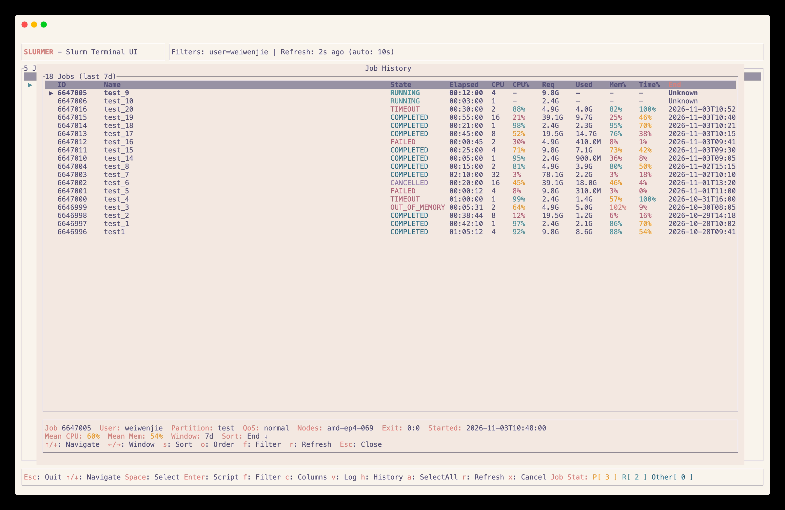
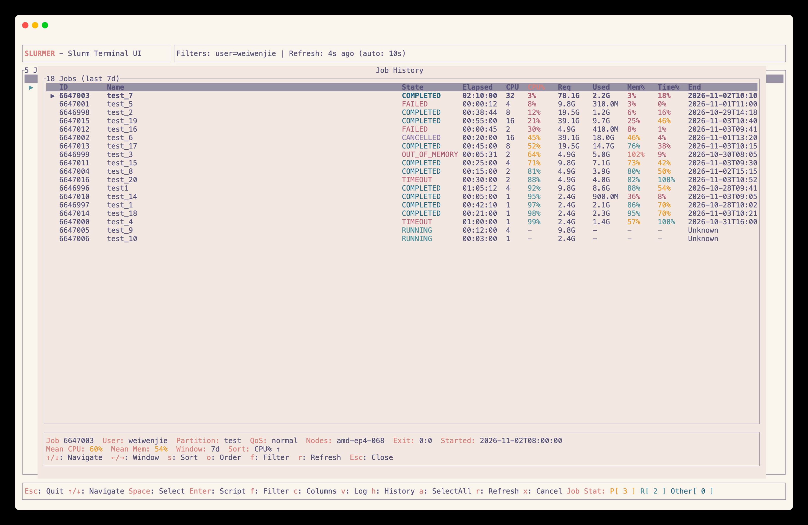

# slurmer

A TUI application for monitoring and managing SLURM jobs.

It provides an intuitive, interactive interface to view, filter, sort, and manage SLURM jobs, making SLURM job management more efficient and user-friendly.

## ✨ Features

- **🔄 Real-time Job Monitoring**: View and refresh SLURM job statuses in real-time

- **🔍 Advanced Filtering**: Filter jobs by user, state, partition, QoS, job name, and more in real-time(regex supported)

- **📊 Customizable Columns**: Flexibly configure which job information columns to display and in what order

- **📝 Job Details View**: Examine job scripts and job logs
<br>
- **🎮 Job Management**: Cancel selected jobs

- **📈 Job History & Efficiency**: Review past jobs from the Slurm accounting database and see how much of the CPU, memory and walltime they reserved was actually used, so over-allocated jobs are easy to spot
<br>

  - **CPU%** — `TotalCPU / (AllocCPUS x Elapsed)`: how much of the reserved CPU time the job burned, the same ratio `seff` reports
  - **Mem%** — peak `MaxRSS` over the memory allocated per node
  - **Time%** — elapsed time over the requested time limit

  Running and pending jobs are listed but show `-`, since Slurm only records their CPU and memory usage once their steps finish.

  The history view reuses whatever is set in the filter menu (user, state, partition, QoS, job name and node regexes), and <kbd>←</kbd>/<kbd>→</kbd> moves the time window between 24h, 3d, 7d, 30d and 90d.

  Extra `sacct` fields, such as the job comment, can be added as columns with `SLURMER_HISTORY_FIELDS` (see [Configuration](#️-configuration)).


<!-- | 🔄 **Real-time Job Monitoring** | 🔍 **Advanced Filtering** | 📊 **Customizable Columns** |
|----------------------------------|---------------------------|------------------------------|
| **View and refresh SLURM job statuses in real-time**<br>       | **Filter jobs by user, state, partition, QoS, job name, and more in real-time (regex supported)**<br>  | **Flexibly configure which job information columns to display and in what order**<br>    |

| 📝 **Job Details View**         | 🎮 **Job Management**     |                              |
|----------------------------------|---------------------------|------------------------------|
| **Examine job scripts and job logs**<br><br> | **Cancel selected jobs directly from the UI**<br> |                              | -->

## 🛠️ Installation

```bash
cargo install slurmer
```
or install from the latest source code:

```bash
cargo install --git https://github.com/wjwei-handsome/Slurmer.git
```


## 📖 Usage

Just run `slurmer`.

## ⌨️ Keyboard Shortcuts

- <kbd>↓/↑</kbd>: Move up and down in the job list
- <kbd>Shift + ↓/↑</kbd>: Move job in the log-view/script-view
- <kbd>f</kbd>: Open filter menu
- <kbd>c</kbd>: Open column selection menu
- <kbd>v</kbd>: View job logs
- <kbd>h</kbd>: Job history with CPU/memory/walltime efficiency
- <kbd>Enter</kbd>: View job script
- <kbd>Space</kbd>: Select job
- <kbd>a</kbd>: Select all jobs
- <kbd>r</kbd>: Refresh job list
- <kbd>x</kbd>: Cancel selected jobs
- <kbd>Esc</kbd>: Quit application

More detailed keybindings can be found each popup menu.

## 🔗 Dependencies

- slurm utilities (e.g., `squeue`, `scancel`) is required.
- `sacct` and a cluster running Slurm job accounting are required for the job history view.
- [`bat`](https://github.com/sharkdp/bat) is optional for viewing job scripts.

## ⚙️ Configuration

`slurmer` automatically detects available SLURM partitions and QoS in your system and uses the currently logged-in username as the default filter.

To show more `sacct` fields in the job history view, list them in `SLURMER_HISTORY_FIELDS`, using the same `Field%width` form as `sacct --format`. They are added as columns after the built-in ones and are off unless set. For example, to always see job comments, add this to your `~/.bashrc`:

```bash
export SLURMER_HISTORY_FIELDS="Comment%70"
```

Several fields are separated by commas, e.g. `Comment%70,Account,WorkDir%40`, and a field without a width gets 20 columns. `sacct --helpformat` lists every field. Slurm only stores job comments in the accounting database when `AccountingStoreFlags=job_comment` is set in `slurm.conf`, so the `Comment` column stays empty on clusters without it.

## 👥 Contributing

Contributions are welcome! Feel free to submit issues or pull requests.

## 📜 License

Copyright (c) wjwei-handsome <weiwenjie@westlake.edu.cn>

This project is licensed under the MIT license ([LICENSE] or <http://opensource.org/licenses/MIT>)

[LICENSE]: ./LICENSE
